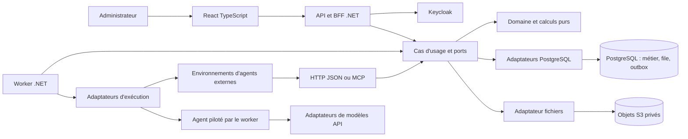
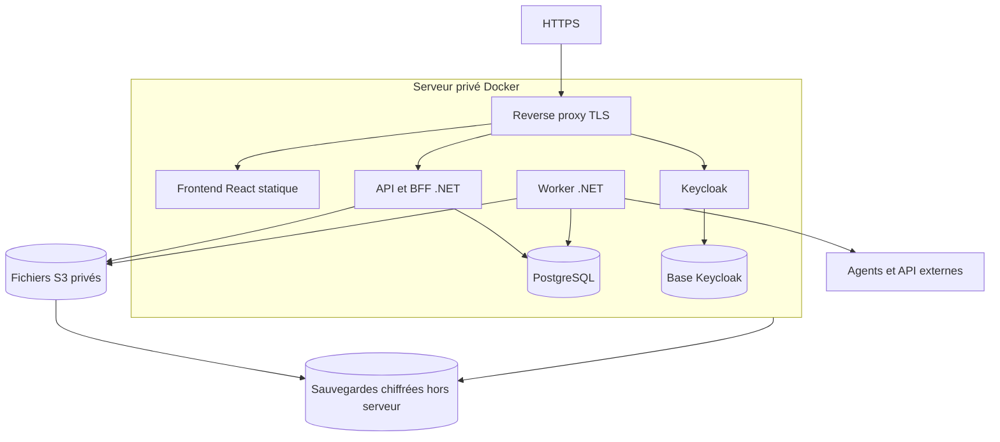

# ImmoTrack V1 — Architecture

Révision consolidée — 10 octobre 2026. Décisions Q101–128 et Q145–152.

## 1. Architecture retenue

Monolithe modulaire .NET en architecture hexagonale, frontend React TypeScript, API/BFF et worker séparés. PostgreSQL porte les données et la file durable ; Keycloak gère l'identité humaine ; les fichiers résident dans un stockage privé compatible S3. Le premier déploiement est un serveur privé Docker, avec sauvegardes externes. L'organisation reste portable vers des services managés.

Les agents enrichissent les données. L'application reste seule responsable des calculs, critères, identités métier et décisions d'enregistrement. « Plusieurs modèles dès la V1 » signifie adaptateurs et intégrations effectivement testés, pas compatibilité universelle avec toute API ni mêmes capacités chez tous les agents.

## 2. Vue d'ensemble

Le diagramme représente les échanges à l'exécution. Les dépendances de code pointent vers les interfaces internes, jamais depuis le domaine vers un adaptateur.

## 3. Frontières de code

| Couche | Responsabilité | Dépendances autorisées |
| --- | --- | --- |
| Domaine | Entités, invariants, conformité, finance, scoring et politiques pures. | Bibliothèque standard ; aucun framework technique. |
| Application | Cas d'usage, transactions logiques, ports, coordination et autorisation métier. | Domaine et contrats internes. |
| Contrats externes | DTO HTTP/MCP, validation syntaxique, OpenAPI/JSON Schema. | Types de sérialisation/validation, sans domaine ni persistance. |
| Infrastructure | EF Core, SQL, S3, Keycloak/OIDC, agents/modèles, horloge et observabilité. | Ports applicatifs et domaine. |
| Entrées | Contrôleurs, outils MCP, commandes worker ; traduction vers cas d'usage. | Application et contrats externes. |
| Composition | Assemblage des ports et adaptateurs dans API et worker. | Infrastructure et application. |
| Frontend | Présentation, saisie et retours utilisateur. | API typée ; aucun accès direct à PostgreSQL ou aux jetons IA. |

Clean Code : langage métier, fonctions ciblées, noms explicites, invariants testés, erreurs typées, injection explicite. L'architecture ne doit pas multiplier les interfaces sans besoin de frontière ou de test. Pas de calcul de référence dans React, de services métier dans les contrôleurs ni de DTO EF exposés au domaine.

## 4. Modules proposés

| Module | Propriété des données et responsabilité |
| --- | --- |
| Recherches | Critères/version, stratégie, zones, sources choisies, programmation et activation. |
| Catalogue immobilier | Biens, lots, annonces, observations, corrections, disponibilité, rapprochement/défusion. |
| Dossiers d'investissement | Rattachement bien–recherche, qualification, dérogations et hypothèses spécifiques. |
| Évaluations | Instantanés d'entrée, scénarios, finance, score, historique et génération courante. |
| Opérations agents | Tâches, tentatives, intégrations/capacités, progression, budgets, relais et arrêt. |
| Documents | Objets, provenance, suggestions d'extraction et validation. |
| Identité/audit | Acteurs, périmètres d'autorisation, sessions et traçabilité. |

Les modules restent dans le même backend et peuvent participer à une transaction PostgreSQL lorsque nécessaire. Les écritures sont coordonnées par les cas d'usage, pas par des accès libres aux tables d'un autre module. Les projections de lecture peuvent agréger plusieurs modules sans créer une seconde source de vérité.

## 5. Ports principaux

- Repositories ciblés : PropertyRepository, SearchRepository, SimulationRepository, TaskRepository.
- UnitOfWork/TransactionBoundary : transaction courte, sans fuite de DbContext.
- JobQueue et Outbox : création durable, réservation, renouvellement de bail, invalidation et reprise.
- AgentExecutor : déclenchement, récupération d'état et arrêt selon capacités déclarées ; expose clairement Unsupported/Unknown lorsque nécessaire.
- ModelGateway : appel de modèle pour les agents pilotés par le worker, outils/vision/sortie structurée et usage selon fournisseur.
- PrivateObjectStore : dépôt, intégrité, lecture autorisée et cycle des fichiers.
- IdentityProvider/ActorContext : identité normalisée ; aucune dépendance métier au SDK Keycloak.
- SecretStore, Clock, IdGenerator, AuditTrail, UsageMeter : accès techniques contrôlés.

Les adaptateurs peuvent être remplacés sans modifier les règles financières. Remplacer un environnement d'agent peut modifier ses capacités ; l'interface ne doit pas masquer cette différence sous un faux équivalent fonctionnel.

## 6. Flux fiables

### Demande de recherche

API → vérifier identité/activation/exécution active → figer critères → enregistrer run et tâche → retour à l'interface. Worker → réserver capacité/budget et tentative → appeler l'agent → recevoir lots/progression via les mêmes cas d'usage. Le planificateur suit cette même entrée ; il ne contourne pas les contrôles.

### Réception d'un lot

Authentification → autorisation de tentative → validation de l'enveloppe → idempotence → validation par item → transaction des résultats/compteurs/reçus/outbox → accusé. Les fichiers S3 suivent une finalisation distincte ; aucune transaction distribuée n'est supposée.

### Recalcul

Changement de fait/hypothèse → génération cible et outbox en transaction → calcul pur dans le worker → écriture immuable → promotion seulement si génération toujours courante. Les anciens résultats restent consultables et explicitement obsolètes.

### Relais ou annulation

Invalider le droit d'écriture de la tentative précédente → demander son arrêt si possible → conserver les effets déjà acquis → reprendre ou relayer selon capacités/budget. Un fournisseur peut encore facturer un appel engagé. Une réponse réseau ambiguë nécessite réconciliation, pas répétition aveugle.

## 7. Déploiement initial

**Proposition de réalisation :** Docker Compose, reverse proxy TLS, même origine web/API pour simplifier BFF/CSRF. PostgreSQL peut héberger deux bases/rôles séparés, ImmoTrack et Keycloak, sur une même instance. Les conteneurs et volumes sont distincts ; la base n'est pas exposée publiquement. Aucun orchestrateur Kubernetes requis en V1.

La file PostgreSQL et l'outbox évitent un broker supplémentaire. Le worker et l'API ont limites de ressources séparées. Pas d'inférence de gros modèles hébergée sur ce VPS dans le chiffrage initial ; les modèles sont appelés via leurs services. Une collecte navigateur locale éventuelle fait l'objet d'un test mémoire/CPU avec concurrence bornée.

Un serveur unique est un point de panne commun accepté au regard du RTO de 24 h. Cela ne constitue pas une haute disponibilité. Le stockage sans expiration exige un suivi du volume ; le plafond de 20 €/mois n'est pas une garantie de capacité infinie. Le candidat d'hébergement et les hypothèses de coût sont documentés dans le document 06.

## 8. Sécurité et reprise

Keycloak MFA et compte administrateur explicitement autorisé ; BFF conserve les jetons, cookie HttpOnly/Secure et CSRF. Chaque intégration possède une identité technique révocable et des permissions limitées. Les secrets fournisseurs sont chiffrés côté serveur, clé distincte de la base et procédure de rotation/restauration.

Stockage objets privé, accès temporaire autorisé ; provenance et intégrité vérifiées. Les pages web/documents sont des entrées non fiables, sans pouvoir de modifier les règles d'autorisation ou les instructions de collecte. Les tâches n'ont ni accès arbitraire à la base ni secrets de toutes les intégrations.

Sauvegarde quotidienne : données ImmoTrack, identité Keycloak, fichiers et clés nécessaires, avec manifestes de cohérence. Conservation 30 jours quotidiens et un an mensuel. Restaurer sur un environnement local isolé pour vérifier RPO/RTO, clés et références de fichiers. Révoquer les anciennes tentatives/sessions avant remise en service.

## 9. Livraison et évolution

Développement local complet et production. CI vérifie code, dépendances, calculs, contrats, transactions et migrations ; build immuable. Déploiement manuel automatisé, courte maintenance, sauvegarde, migration contrôlée et smoke test. Le retour applicatif doit être compatible avec la migration ; sinon utiliser une restauration explicitement prévue.

Migration future possible vers PostgreSQL managé, stockage autre fournisseur ou worker sur une autre machine. Le passage éventuel à un broker ou à des services séparés repose sur un besoin mesuré, sans être requis pour livrer la V1.

## 10. Décisions d'architecture à tracer

| ADR | Décision / origine |
| --- | --- |
| ADR-001 | Monolithe modulaire hexagonal .NET, React TypeScript — Q101/Q104. |
| ADR-002 | PostgreSQL, EF Core écritures et lectures dédiées — Q103/Q150. |
| ADR-003 | Worker séparé, file PostgreSQL et outbox transactionnelle — Q105/Q106/Q147/Q148. |
| ADR-004 | Keycloak MFA, BFF et identités agents séparées — Q107–109/Q115–116. |
| ADR-005 | Stockage S3 privé et protocole de finalisation — Q110, proposition technique. |
| ADR-006 | Orchestrateur, exécuteurs et modèles séparés ; contrat versionné — Q145–146. |
| ADR-007 | Idempotence, baux/générations et concurrence optimiste — Q119/Q147/Q149. |
| ADR-008 | VPS Docker initial, sauvegardes externes et budget — Q122–127/Q151–152. |

Ces ADR sont résumés ici ; les preuves et détails de bibliothèque seront ajoutés lors des tranches techniques. Les essais d'intégration Work/API et de restauration restent des conditions de recette, pas des acquis.
