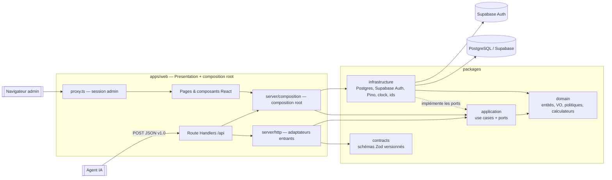
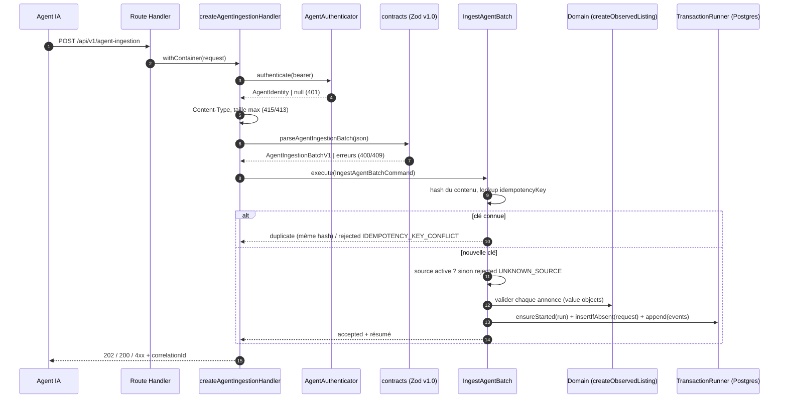

# Architecture

ImmoTrack est un **monolithe modulaire** organisé en **architecture hexagonale** (ports &
adapters / Clean Architecture). Voir [ADR-001](adr/ADR-001-modular-monolith-hexagonal.md).

## Règle de dépendance

Toutes les dépendances de code pointent vers le domaine :

```text
Domain  <-  Application  <-  Infrastructure / Presentation
```



| Package                                                     | Peut dépendre de                               | Interdit (vérifié en CI)                                            |
| ----------------------------------------------------------- | ---------------------------------------------- | ------------------------------------------------------------------- |
| `@immotrack/domain`                                         | rien (ES2023 standard uniquement)              | tout package npm, Node.js, DOM, autres packages                     |
| `@immotrack/application`                                    | `domain`                                       | SQL, SDK Supabase, Next.js, contrats HTTP                           |
| `@immotrack/contracts`                                      | `zod`                                          | base de données, UI, use cases                                      |
| `@immotrack/infrastructure`                                 | `application`, `domain`, librairies techniques | `apps/*`, React, Next.js, contrats HTTP                             |
| `apps/web`                                                  | `application`, `contracts`, `infrastructure`   | `domain` en direct ; `infrastructure`/`pg`/`pino` hors `src/server` |
| `@immotrack/test-utils` et `@immotrack/application/testing` | —                                              | importés par du code de production                                  |

Ces règles sont exprimées dans [`.dependency-cruiser.cjs`](../.dependency-cruiser.cjs)
(`pnpm lint:architecture`). pnpm ajoute une seconde barrière : un package ne peut résoudre que
les dépendances qu'il déclare.

Le domaine est compilé avec `lib: ES2023` et `types: []` : il ne peut même pas _nommer_ une API
Node.js ou navigateur. Le seul standard utilisé (le parseur d'URL WHATWG) est déclaré localement
dans `domain/src/shared/whatwgUrl.ts`.

## Couches

| Couche            | Emplacement                                   | Contient                                                                         | Ne contient pas                        |
| ----------------- | --------------------------------------------- | -------------------------------------------------------------------------------- | -------------------------------------- |
| Domain            | `packages/domain/src`                         | value objects, entités, politiques, calculateurs purs, violations                | I/O, DTO HTTP, SQL, SDK, React         |
| Application       | `packages/application/src`                    | use cases, commandes/résultats, ports, erreurs techniques typées                 | Supabase, SQL concret, UI              |
| Adapters entrants | `apps/web/src/server/http`, `src/app/api`     | auth agent, limites, validation de contrat, mapping DTO ↔ commande, présentation | règles financières ou de déduplication |
| Adapters sortants | `packages/infrastructure/src`                 | repositories PostgreSQL, Supabase Auth, logger, horloge, UUID, hachage           | décisions métier                       |
| Composition root  | `apps/web/src/server/composition`             | assemblage des implémentations                                                   | règles fonctionnelles                  |
| UI                | `apps/web/src/app`, `apps/web/src/components` | rendu, formatage d'affichage                                                     | calculs, accès DB, adaptateurs         |

## Modules métier

| Module (bounded context)          | Domaine                                                                                               | Application                                     | État du socle                    |
| --------------------------------- | ----------------------------------------------------------------------------------------------------- | ----------------------------------------------- | -------------------------------- |
| `search-runs` (Search Operations) | statuts de run/source, agrégation `deriveSearchRunStatus`                                             | `ListSearchRuns`, ports runs/événements/sources | lecture + écriture par ingestion |
| `listings` (Property Catalog)     | `ObservedListing`, statuts et transitions, `CanonicalUrl`, `SourceReference`, `Surface`, `PostalCode` | `ListListingSummaries`, `ListingQueries`        | lecture                          |
| `deduplication`                   | `findExactMatchLevel` (niveaux 1 et 2)                                                                | —                                               | politique pure testée            |
| `snapshots`                       | `listSignificantChanges`                                                                              | —                                               | politique pure testée            |
| `evaluation`                      | `Percentage`, `calculateGrossYield`, `CALCULATOR_VERSION`                                             | `EvaluationRepository` (port)                   | calculateur exemple              |
| `criteria`                        | `SearchCriteriaVersion`                                                                               | `SearchCriteriaRepository` (port)               | types + seed                     |
| `ingestion`                       | — (s'appuie sur `listing`)                                                                            | `IngestAgentBatch`, ports d'idempotence         | **tranche verticale complète**   |
| `identity` / audit                | —                                                                                                     | `AgentAuthenticator`, `AuditTrail` (ports)      | jeton agent + Supabase Auth      |

`Money` est dans `domain/shared` : il est partagé par le catalogue (prix) et l'évaluation, et
le catalogue ne doit pas dépendre du contexte Evaluation (règle vérifiée en CI).

## Flux : agent → ingestion



Garantie d'idempotence : la contrainte `UNIQUE (idempotency_key)` et un
`INSERT … ON CONFLICT DO NOTHING` dans la transaction ; une requête concurrente portant la même
clé attend la fin de la première puis renvoie son résultat (`duplicate`). Testé en intégration
avec 5 requêtes simultanées.

## Erreurs

| Type                         | Origine                               | HTTP            | Log                                  |
| ---------------------------- | ------------------------------------- | --------------- | ------------------------------------ |
| Contrat invalide             | `contracts` (frontière)               | 400 / 409       | warn                                 |
| Authentification             | `AgentAuthenticator`                  | 401             | warn                                 |
| Refus métier (résultat typé) | use case (`rejected`)                 | 409 / 422       | warn                                 |
| `DomainViolation`            | value objects (annonce rejetée seule) | 202 avec détail | event `LISTINGS_REJECTED`            |
| `InfrastructureError`        | adaptateurs sortants                  | 503             | error + cause                        |
| `ConfigurationError`         | variables d'environnement             | 503             | error (noms de variables uniquement) |
| Inattendue                   | —                                     | 500             | error + stack                        |

Les refus métier sont des **valeurs de retour typées**, pas des exceptions ; les exceptions sont
réservées aux défaillances techniques.

## Observabilité

- Port `Logger` (application) ; adaptateur Pino (JSON une ligne, horodatage ISO, champ `level`).
- Chaque requête reçoit un `correlationId` (en-tête `X-Correlation-Id` accepté s'il est sûr) ;
  il est propagé dans les logs (`child`), dans `agent_events.correlation_id`, dans
  `ingestion_requests.correlation_id` et dans la réponse.
- Champs standard : `correlationId`, `runId`, `sourceCode`, `eventType`, `level`.
- Masquage des clés sensibles (`authorization`, `cookie`, `password`, `token`, `secret`,
  `apiKey`, `databaseUrl`…) en défense en profondeur ; les jetons ne sont jamais passés au logger.

## Données

- PostgreSQL est la source de vérité ; toutes les tables utilisent des UUID et des `timestamptz`.
- Contraintes `FK`, `UNIQUE`, `CHECK` en défense en profondeur des invariants du domaine.
- Snapshots append-only, hypothèses d'évaluation versionnées
  ([ADR-006](adr/ADR-006-immutable-snapshots-and-versioned-inputs.md)).
- RLS activée sans politique : aucun accès via l'API Data Supabase
  ([ADR-003](adr/ADR-003-supabase-postgres-auth.md)).

## Évolution prévue

- Rapprochement niveaux 3/4 (`FindDuplicateCandidates`), snapshots et `RecalculateEvaluation`
  branchés dans `IngestAgentBatch` sans changer le contrat.
- Volume croissant : port `JobScheduler` + outbox, sans modifier le domaine.
- Nouveau canal agent (API, MCP) : nouvel adaptateur entrant + implémentation
  d'`AgentAuthenticator`, use cases inchangés.
- Changement d'hébergeur PostgreSQL : nouvelle configuration des adaptateurs, domaine inchangé.
